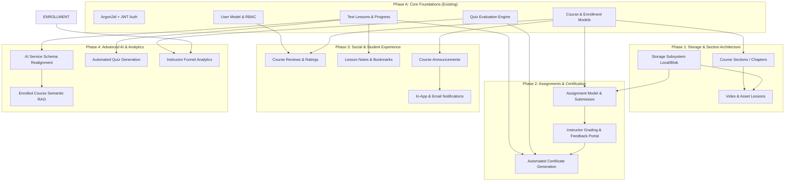

# EduVerse — Production LMS Architectural Feature Gap Analysis

**Document Status:** Approved Architectural Assessment  
**Author:** Senior LMS Product Architect & DevSecOps Engineer  
**Inspection Target:** `C:\EduVerse`  
**Runtime Context:** Windows Local Environment (FastAPI + SQLite + Angular 19)  
**Date:** November 2026  

---

## 1. Executive Summary

EduVerse has successfully completed its initial foundational phases, establishing a functional **FastAPI** backend, an **Angular 19** standalone frontend, an **Argon2id + PyJWT** authentication system, an **Alembic-managed SQLite database** with strict foreign keys and check constraints, and a comprehensive 26-test automated suite.

The system currently delivers core end-to-end LMS workflows:
- User registration and role-based login (Student, Instructor, Administrator).
- Course catalog exploration with search and difficulty/category filtering.
- Course enrollment with unique student-course constraints.
- Granular lesson consumption and dynamic course completion percentage recalculation.
- Multiple-choice quiz assessments with strict server-side evaluation, zero client-side answer key leakage, and permanent historical attempt preservation.
- Administrative user oversight with role elevation and account status toggles.

However, transforming EduVerse from this modular prototype into a **production-ready, enterprise-grade Learning Management System** reveals substantive feature gaps across all five operational pillars. Most critically:
1. **Curriculum Hierarchy & Media**: Courses currently have a flat list of text-only lessons. Hierarchical sections/modules, video streaming, slide decks, and downloadable assets are absent.
2. **Assignments & Subjective Grading**: While objective multiple-choice quizzes are complete, subjective assignments (file uploads, deadlines, rubrics, instructor grading, and feedback) do not exist.
3. **Certification & Social Proof**: Automated certificate issuance upon 100% course completion and student reviews/ratings are missing.
4. **AI Architecture Mismatch**: The AI assistant service contains a schema discrepancy (`TypeError` on `course_id`/`messages_json` due to Phase 3 entity normalization into separate `AIMessage` records) and currently lacks semantic document retrieval (RAG) and quiz generation capabilities.
5. **Platform Operations**: Absence of an asynchronous task worker (Celery/Redis or BackgroundTasks) for transactional email notifications, lack of an S3/Azure Blob file storage abstraction, and absence of an immutable administrative audit log.

This document details an evidence-based gap analysis, a classification matrix across all modules, identified data integrity concerns, and a phased implementation roadmap.

---

## 2. Feature-by-Feature Status Matrix

### Legend
- **COMPLETE**: Implemented, verified, and backed by working UI, backend API, database constraints, and tests.
- **PARTIAL**: Operational foundation exists, but the user workflow or data model is incomplete.
- **UI ONLY**: Visual screen or controls exist without complete functional persistence or backend wiring.
- **MISSING**: No meaningful implementation found in frontend, backend, or database.
- **NEEDS VERIFICATION**: Insufficient evidence to confirm functionality.

---

### Module A: Student Experience

| Feature | Status | Evidence (Files, Endpoints, Models, Tests) | What Is Missing or Incomplete | Dependencies | Suggested Next Steps |
| :--- | :--- | :--- | :--- | :--- | :--- |
| **Dashboard & Catalogue** | **COMPLETE** | `frontend/.../student-dashboard.component.ts` `frontend/.../my-learning.component.ts` `frontend/.../student-assignments.component.ts` `frontend/.../student-quiz-history.component.ts` `GET /api/v1/student/dashboard` `GET /api/v1/student/my-learning` `GET /api/v1/student/courses/{id}/continue` `GET /api/v1/student/assignments` `GET /api/v1/student/quiz-history` `GET /api/v1/student/recommendations` `test_student.py` (8 tests) | Phase 7 delivered comprehensive student learning experience: live telemetry KPIs, continue-learning next lesson resolver, upcoming assignment deadlines, recent assessment grades, dedicated "My Learning" portal with lesson counts (`X / Y`), centralized assignment tracker, and quiz history. | None | Verified in Phase 7 with 82 backend tests passing. |
| **Enrollment & Access** | **COMPLETE** | `CourseEnrollment` model `POST /api/v1/courses/{id}/enroll` `test_courses.py` | Course unenrollment/drop workflow; prerequisite enforcement before enrollment. | Course Model | Implement enrollment status states (`active`, `dropped`, `completed`). |
| **Video & Document Lessons** | **PARTIAL** | `Lesson` model `LearningMaterial` model `CourseLearnComponent` `test_materials.py` | Downloadable PDF, DOCX, PPTX, and image course materials are now implemented and securely delivered. Video player with playback timestamp tracking remains to be integrated. | Video Subsystem | Integrate HTML5/HLS video player with playback position persistence. |
| **Lesson Progress & Persistence** | **COMPLETE** | `LessonProgress` model `POST /api/v1/lessons/{id}/complete` `test_courses.py` | Resume at last-viewed lesson timestamp; auto-mark as complete after video finishes. | Video Player | Add `last_accessed_at` timestamp and media playback position persistence. |
| **Quizzes, Attempts & Results** | **COMPLETE** | `quizzes`, `questions`, `quiz_attempts` `/api/v1/quizzes/*` `test_quizzes.py` | Full instructor authoring/editing/preview, question reordering, dynamic options, passing scores, time limits with real-time countdown timer & auto-submit, attempt quotas, draft/published toggle, and instant server-side grading. | None | Verified in Phase 4 with 54 backend tests passing. |
| **Assignment Submission & Grading** | **COMPLETE** | `Assignment` & `AssignmentSubmission` models `/api/v1/assignments/*` `AssignmentDetailComponent` `test_assignments.py` (6 tests) | Implemented full assignment submission, resubmission control, automatic deadline enforcement, and grade/feedback viewing. File upload is documented as an upcoming dependency. | Course Enrollment | Integrate cloud file storage (S3/Azure Blob) in future storage subsystem phase. |
| **Certificates & Completion Criteria** | **MISSING** | No certificate models or PDF generators found. | Verification of quiz passing + 100% lesson completion $\to$ unique certificate generation with verifiable public hash/URL. | Course Enrollment | Create `Certificate` table, cryptographic verification endpoint, and downloadable SVG/PDF generator. |
| **Bookmarks, Notes & Study History** | **MISSING** | No bookmark or note models found. | In-lesson markdown note-taking widget, bookmarking specific lessons, and study calendar. | Lesson Progress | Implement `LessonNote` and `LessonBookmark` models and integrated UI sidebar. |
| **Notifications & Course Reviews** | **MISSING** | No review/rating models or notification tables found. | In-app notification bell, email dispatch, course star ratings, and written reviews. | User Model, Course Model | Add `Notification` and `CourseReview` models with average rating recalculation. |
| **Accessibility & Responsive Design** | **PARTIAL** | `styles.css` responsive media queries, CSS variables, semantic tags. | Missing WCAG 2.1 AA audit, ARIA live-regions for dynamic quiz feedback, and keyboard focus trap tests. | Frontend UI | Audit with axe-core / Lighthouse; add ARIA roles, live regions, and contrast validation. |

---

### Module B: Instructor Experience

| Feature | Status | Evidence (Files, Endpoints, Models, Tests) | What Is Missing or Incomplete | Dependencies | Suggested Next Steps |
| :--- | :--- | :--- | :--- | :--- | :--- |
| **Course Lifecycle (Draft/Publish/Archive)** | **PARTIAL** | `POST/PUT /api/v1/instructor/courses` `PATCH /api/v1/instructor/courses/{id}/publish` `check_course_ownership` | Only boolean `is_published`. Missing `archived` status, course duplication/cloning, and course thumbnail image upload. | Course Model | Add `status` enum (`draft`, `published`, `archived`) and course cloning utility. |
| **Sections & Lesson Management** | **COMPLETE** | `CourseSection` model `a16c509c4e04_add_course_sections.py` `/api/v1/instructor/courses/{id}/sections` `LessonEditorComponent` `test_sections.py` (5 tests) | Implemented full hierarchical module support, safe section deletion with lesson reassignment, order indexing, and UI section management. | Course Model | Extend to support module-level prerequisites and completion locks in future phases. |
| **Secure Content Upload & Delivery** | **COMPLETE** | `LearningMaterial` model `b215a54d351b_add_learning_materials.py` `/api/v1/instructor/courses/{id}/materials` `/api/v1/materials/*` `MaterialManagerComponent` `MaterialService` `test_materials.py` (5 tests) | Implemented full storage abstraction (LocalStorageProvider ready for AzureBlobStorageProvider), file validation (magic bytes, extensions, size limits), strict server-side authorization, and zero-exposure storage paths. | Course Model | Extend to video streaming uploads in video player phase. |
| **Quiz & Assignment Creation** | **COMPLETE** | `quizzes` & `assignments` tables `/api/v1/instructor/courses/{id}/assignments` `AssignmentManagerComponent` `test_assignments.py` | Full instructor assignment authoring with maximum marks, instructions, deadlines, resubmission toggle, and safe archival controls. | Course Model | Extend with downloadable file attachments in file storage phase. |
| **Assignment Grading & Feedback** | **COMPLETE** | `PUT /api/v1/instructor/submissions/{id}/grade` `AssignmentManagerComponent` grading modal `test_assignments.py` | Complete instructor grading workflow with strict mark boundary validation, written qualitative feedback, grading timestamps, and instructor attribution. | Assignment Submissions | Add rubric item breakdown and bulk export in advanced analytics phase. |
| **Student Roster & Progress** | **COMPLETE** | `CourseAnalyticsComponent` `GET /api/v1/instructor/courses/{id}/student-report` `GET /api/v1/instructor/courses/{id}/students/{student_id}/progress` `GET /api/v1/instructor/courses/{id}/student-report/csv` `test_analytics.py` (9 tests) | Implemented full student roster inspection with completion %, assignment grades/feedback, quiz scores/history, objective assistance indicators ("Needs Attention", "In Progress", "Completed"), and CSV export with RFC 4180 formula injection sanitization. | None | Verified in Phase 5 with 64 backend tests passing. |
| **Announcements & Discussions** | **COMPLETE** | `CourseAnnouncement`, `CourseDiscussion`, `DiscussionReply` models `151078c181dd_add_discussions_announcements_and_.py` `/api/v1/courses/{id}/announcements` `/api/v1/courses/{id}/discussions` `CourseAnnouncementsComponent`, `CourseDiscussionsComponent` `test_discussions_and_announcements.py` (5 tests) | Complete faculty course announcements (draft vs published), rich discussion forums with live search, pagination, pinned topics, threaded replies, author/moderator permissions, and soft-delete masking. | Course Model | Verified in Phase 8 with 87 backend tests passing. |
| **Course Analytics** | **COMPLETE** | `CourseAnalyticsComponent` `InstructorDashboardComponent` `GET /api/v1/instructor/dashboard` `GET /api/v1/instructor/courses/{id}/analytics` `analytics_service.py` `test_analytics.py` (9 tests) | Aggregated KPIs (enrolled students, completion %, assignments & submissions, pending grading alerts, quiz attempts/averages/pass rates), individual assessment breakdowns, and cross-course dashboard analytics. | Analytics Engine | Verified in Phase 5 with 64 backend tests passing. |

---

### Module C: Administrator Governance

| Feature | Status | Evidence (Files, Endpoints, Models, Tests) | What Is Missing or Incomplete | Dependencies | Suggested Next Steps |
| :--- | :--- | :--- | :--- | :--- | :--- |
| **User Directory & Account Status** | **COMPLETE** | `UserManagementComponent` `GET /api/v1/admin/users` `PUT /api/v1/admin/users/{id}` `test_admin.py` (11 tests) | Implemented full user directory with pagination, search, role filters, active status filters, account activation/deactivation, role promotion/change, confirmation dialogs, and strict self-deactivation & self-demotion protection. | User Model | Verified in Phase 6 with 74 backend tests passing. |
| **Role Management & Enforcement** | **COMPLETE** | `require_admin`, `require_instructor`, `require_student` `role.guard.ts` `test_admin.py` | Strict RBAC enforcement across all administrative and faculty endpoints. Prevents self-demotion and role tampering. | Auth Subsystem | Verified in Phase 6 with 74 backend tests passing. |
| **Instructor Approval Workflow** | **PARTIAL** | Admin can change user role to `instructor` in `/admin/users`. | No formal instructor application queue with CV/bio review documents. | User Model | Create `InstructorApplication` model (`user_id`, `qualifications`, `status`, `reviewed_by`). |
| **Course Moderation & Review** | **COMPLETE** | `CourseManagementComponent` `GET /api/v1/admin/courses` `GET /api/v1/admin/courses/categories` `PATCH /api/v1/admin/courses/{id}/publish` `test_admin.py` | Full administrative course catalog with pagination, search, category filter, publication status filter, batch metric aggregation (enrolled learners, lessons, quizzes, tasks), publication state toggle, confirmation dialogs, and public preview links. | Course Model | Verified in Phase 6 with 74 backend tests passing. |
| **Categories & Platform Settings** | **PARTIAL** | Categories are free-text strings on `courses`. Platform stats on `/admin/dashboard`. | No normalized `Category` table (allows typos/duplicates); no dynamic system configuration UI (SMTP, maintenance mode). | Database | Create `Category` model with slug and icon; create `SystemSetting` key-value store. |
| **Audit Logs & Support Management** | **MISSING** | No audit logging or support ticket entities found. | Immutable log of administrative actions (who promoted whom, who deleted which course); user support ticket inbox. | Admin Subsystem | Create `AuditLog` table with actor, action, target, IP address, and timestamp. |

---

### Module D: AI Learning Assistant

| Feature | Status | Evidence (Files, Endpoints, Models, Tests) | What Is Missing or Incomplete | Dependencies | Suggested Next Steps |
| :--- | :--- | :--- | :--- | :--- | :--- |
| **AI Tutor Integration** | **COMPLETE** | `AIConversation` (with `course_id`) & `AIMessage` relational models `handle_ai_chat` `test_ai.py` (7 tests) `test_ai_advanced.py` (7 tests) `AIAssistantComponent` | Full multi-turn conversation persistence, ownership security, syllabus context grounding, and offline fallback provider verified. | AI Schema & Models | Future expansion: optional live cloud LLM fallback (Gemini/OpenAI) with student opt-in. |
| **Contextual Course Grounding** | **COMPLETE** | `POST /api/v1/ai/chat` `check_course_access`, `check_lesson_access` `test_course_and_lesson_grounded_chat` `AIAssistantComponent` (Grounding dropdowns & pills) | Course & lesson text grounding enforced. Unenrolled access returns 403 Forbidden. Explicitly disclaims when concepts are outside course syllabus. | Course & Lesson Models | Verified in Phase 9 with 94 backend tests passing. |
| **Lesson Summarization** | **COMPLETE** | `POST /api/v1/ai/lessons/{lesson_id}/summarize` `summarize_lesson_service` `test_lesson_summarization` `CourseLearnComponent` (Summary modal) | Extracts overview and key takeaways from lesson text; enforces $\ge 10$ words; verifies enrolled course authorization. | Lesson Model | Verified in Phase 9 with 94 backend tests passing. |
| **AI Practice Question Drills** | **COMPLETE** | `POST /api/v1/ai/lessons/{lesson_id}/practice-questions` `generate_practice_questions_service` `test_practice_question_generation_academic_integrity` `CourseLearnComponent` (Practice modal) | Generates grounded multiple-choice drills with immediate feedback, concept tags, and official disclaimer. Academic integrity: zero access to official course exams. | Lesson Model, Quiz Isolation | Verified in Phase 9 with 94 backend tests passing. |
| **Personalized Study Recommendations** | **COMPLETE** | `GET /api/v1/ai/study-recommendations` `get_student_study_recommendations` `test_personalized_study_recommendations` `AIAssistantComponent` (Study Plans tab) | Algorithmic suggestions based on uncompleted lessons, failed quizzes below passing threshold, and upcoming assignments. Strict student isolation. | Student Progress Telemetry | Verified in Phase 9 with 94 backend tests passing. |
| **Course Recommendations** | **COMPLETE** | `GET /api/v1/student/recommendations` `student_service.get_recommended_courses` `test_student.py` (8 tests) | Content-based recommendations suggesting published courses in categories matching the student's enrolled subjects, strictly deduplicating already-enrolled courses. | Enrollment Model | Verified in Phase 7 with 82 backend tests passing. |
| **AI Privacy & Safety Controls** | **COMPLETE** | Strict RBAC & enrollment isolation (403 for non-enrolled students) Safe credential handling via `config.py` Zero secrets exposed to frontend | Offline local pedagogical provider functions safely without credentials; external keys validated if provided. | Auth & Config | Future expansion: configurable student opt-out flag for third-party AI APIs. |

---

### Module E: Platform, Architecture & DevSecOps

| Feature | Status | Evidence (Files, Endpoints, Models, Tests) | What Is Missing or Incomplete | Dependencies | Suggested Next Steps |
| :--- | :--- | :--- | :--- | :--- | :--- |
| **Authentication & Token Lifecycle** | **PARTIAL** | Argon2id password hashing via `pwdlib` JWT bearer tokens via `PyJWT` `test_auth.py` | No refresh token rotation (students are logged out once the short-lived access token expires); no email verification or forgot-password token flow. | User Model | Implement refresh token table with rotation; add password reset token generation. |
| **Resource Ownership Verification** | **COMPLETE** | `check_course_ownership` `get_lesson_for_user` `get_attempt_detail` | Robust checks prevent IDOR on course editing, lesson viewing, and quiz review. | Auth Subsystem | Maintain ownership checks across new assignment and certificate endpoints. |
| **API Validation & Error Handling** | **COMPLETE** | Pydantic v2 schemas across all routers; standard HTTP error codes (400, 401, 403, 404, 409, 422); defensive HTTP security headers (`X-Content-Type-Options: nosniff`, `X-Frame-Options: DENY`, `X-XSS-Protection`, `Referrer-Policy`); global unhandled exception masking; in-memory sliding-window rate limiting on `/auth/login`. | External distributed rate limiting (e.g., Redis cluster) for multi-node deployments. | Security Subsystem | Verified in Phase 10 with 102 backend tests passing. |
| **Database Architecture & Migrations** | **COMPLETE** | SQLite with `PRAGMA foreign_keys=ON;` Alembic batch mode migrations `test_database.py` (10 tests) | Ready for PostgreSQL transition. Database is currently local SQLite file. | Alembic | Maintain Alembic batch configuration to ensure portable PostgreSQL schema generation. |
| **File Storage Subsystem** | **COMPLETE** | `LearningMaterial` model `LocalStorageProvider` (`storage.py`) `file_validator.py` `test_materials.py` (5 tests) `test_security.py` | Pluggable storage architecture outside frontend web root; strict 25 MB size limits, dangerous extension blocklist, magic byte header verification, path traversal checks, unguessable UUID storage keys, and enrollment/ownership download authorization. | Backend Core | Verified in Phase 3 & 10 with 102 backend tests passing. |
| **Search, Pagination & Indexing** | **PARTIAL** | DB indices on `email`, `role`, `course.title`, `is_published`. API supports `skip` and `limit`. | Frontend lacks pagination controls (only fetches first 50); backend uses `LIKE %term%` instead of Full-Text Search. | Frontend / Backend | Add Angular pagination component; implement SQLite FTS5 / PostgreSQL tsvector. |
| **Notifications & Email Service** | **PARTIAL** | `Notification` model `/api/v1/notifications/*` `NavbarComponent` bell & interactive dropdown `test_discussions_and_announcements.py` | In-app persistent notification subsystem is complete with unread counter badge, automated triggers on course announcements and discussion replies, mark-as-read actions, and user isolation. External email provider (SMTP/SendGrid) remains for external notification phase. | Config | Integrate background task email provider in DevOps/Notifications phase. |
| **Logging, Observability & Backups** | **PARTIAL** | Uvicorn stdout logging; `/health` endpoint returning database connectivity status; sanitized global exception handler. | Missing structured JSON logging (correlation ID, user_id), automated database backup cron, and Prometheus metrics. | Backend Core | Implement structured logging middleware with correlation IDs and automated backup script. |
| **Automated Testing Suite** | **COMPLETE** | 102 pytest unit/integration tests passing across 14 modules. Dedicated security suite (`test_security.py`). Frontend builds with zero warnings (`ng build`). | Browser end-to-end smoke tests (Playwright) and load testing (Locust) for future DevOps phase. | CI Pipeline | Verified in Phase 10 with 102 backend tests passing. |
| **Configuration & Secret Handling** | **COMPLETE** | Pydantic Settings (`app/config.py`) Production secret key entropy validator `.env.example` templates Production secret warning | Safe defaults for dev; environment-driven variables. Rejects dev secret key in production. | None | Verified in Phase 10 with 102 backend tests passing. |

---

## 3. Existing Capabilities That Must Be Preserved

During future development, the following battle-tested components must **not** be broken, altered destructively, or degraded:

1. **Security & Password Hashing**:
   - `backend/app/security/password.py`: Strict Argon2id hashing via `pwdlib` and password strength verification (min 8 chars, uppercase, lowercase, digit, symbol). Plaintext passwords must never touch storage.
2. **Access Control & RBAC**:
   - `backend/app/security/rbac.py`: Functional FastAPI dependency checks (`require_admin`, `require_instructor`, `require_student`) enforcing least-privilege boundaries.
   - Public student registration must **never** allow role escalation to instructor or admin.
3. **Assessment Integrity (No Answer Leakage)**:
   - `backend/app/services/quiz_service.py` (`get_quiz_for_student`): Strictly projects questions without `is_correct` flags or explanations to prevent cheating via browser DevTools.
   - Evaluation is strictly executed server-side.
4. **Historical Attempt Preservation**:
   - `backend/app/models/quiz.py` (`QuizAttempt`): Uses `ondelete="SET NULL"` on `student_id` and `quiz_id`. Historical assessment grades and answers must never be purged even if a quiz or user is deleted.
5. **Database Relational Integrity**:
   - `backend/app/database.py`: The `PRAGMA foreign_keys=ON;` connection hook must remain active to prevent orphaned records in SQLite.
   - `backend/alembic/env.py`: `render_as_batch=True` must be preserved for constraint migrations on SQLite.
6. **Dynamic Progress Recalculation**:
   - `backend/app/services/lesson_service.py` (`mark_lesson_complete`): Dynamically recalculates `completion_percentage` on `CourseEnrollment` in an atomic transaction upon each lesson completion.
7. **Frontend Design System & UX Standards**:
   - `frontend/src/styles.css`: Established modern Indigo/Slate SaaS theme with custom utilities, accessible forms, responsive breakpoints, and badge states.

---

## 4. Discovered Bugs & Architectural Inconsistencies

During code inspection and runtime execution, three structural inconsistencies were identified that must be remediated:

### Bug 1: AI Chat Service Schema Inconsistency [RESOLVED - PHASE 1]
- **Location**: `backend/app/services/ai_service.py` (`handle_ai_chat`, lines 166–204)
- **Status**: **RESOLVED**
- **Resolution**: Refactored `ai_service.py` to create `AIConversation(user_id=..., title=...)`, insert incoming user prompts as `AIMessage(role="user", ...)`, and persist assistant responses as `AIMessage(role="assistant", ...)`. Added chronological sorting, multi-turn history retrieval, 403 authorization checks, and comprehensive test suite (`test_ai.py`, 7/7 passing).

### Bug 2: Missing Course ID in Quiz Attempt Summary Schema
- **Location**: `backend/app/schemas/quiz.py` vs `backend/app/services/quiz_service.py`
- **Root Cause**: `list_user_attempts` populates `course_id=a.quiz.course_id`, but `QuizAttemptSummary` does not always expose `course_title` or course navigation links directly to the frontend table, requiring extra lookups.
- **Resolution**: Enrich `QuizAttemptSummary` with `course_title` and `course_id`.

### Bug 3: Course Sections Omission [RESOLVED - PHASE 1]
- **Location**: `backend/app/models/course.py` & `backend/app/models/lesson.py`
- **Status**: **RESOLVED**
- **Resolution**: Introduced `CourseSection` model (`id`, `course_id`, `title`, `description`, `order_index`), added nullable `section_id` foreign key (`ondelete="SET NULL"`) on `Lesson`, applied Alembic migration `a16c509c4e04_add_course_sections.py`, implemented instructor section CRUD & reordering APIs with safe deletion checks, and updated Angular frontend (`LessonEditorComponent`, `CourseDetailComponent`, `CourseLearnComponent`) with 5/5 passing automated tests (`test_sections.py`).

---

## 5. Feature Dependency Graph

---

## 6. Prioritized Implementation Roadmap

To maintain local development stability and preserve existing functionality, future development must follow a disciplined, incremental roadmap divided into 6 manageable phases.

---

### Phase 1: AI Assistant Realignment & Course Section Architecture (Immediate Priority)
**Theme**: Fix existing structural defects and introduce hierarchical course curriculum.

- **Tasks**:
  1. Fix `backend/app/services/ai_service.py` to persist individual messages into `AIMessage` rows rather than non-existent `messages_json` and `course_id` columns.
  2. Implement `CourseSection` model (`id`, `course_id`, `title`, `order_index`, `created_at`).
  3. Add `section_id` nullable foreign key to `Lesson`.
  4. Generate and apply Alembic migration (`add_course_sections_table`).
  5. Update `CourseDetailComponent` and `CourseLearnComponent` to render curriculum grouped by collapsible sections.
  6. Update `LessonEditorComponent` to allow assigning lessons to sections.
  7. Add pytest suite in `tests/test_sections.py` and `tests/test_ai_service.py`.

- **Acceptance Criteria**:
  - `POST /api/v1/ai/chat` completes with HTTP 200 and messages persist in `ai_messages`.
  - An instructor can create sections (e.g. "Module 1", "Module 2") and organize lessons within them.
  - Student learning viewer displays grouped curriculum accordion with checkmarks.
  - All existing 26 tests + new tests pass 100%.

---

### Phase 2: Pluggable File Storage Subsystem & Rich Media Lessons
**Theme**: Enable file uploads, PDF viewing, and video streaming.

- **Tasks**:
  1. Create `backend/app/services/storage_service.py` with abstract interface (`upload_file`, `get_file_url`, `delete_file`).
  2. Implement `LocalStorageService` saving files to persistent directory `backend/data/uploads/` with UUID-based filenames and MIME-type validation.
  3. Serve static uploaded media safely with authentication/token validation.
  4. Extend `Lesson` model with `lesson_type` (`text`, `video`, `document`), `media_url`, and `duration_minutes`.
  5. Add video player and document viewer components to frontend `CourseLearnComponent`.
  6. Add course thumbnail upload to `CourseEditorComponent`.

- **Acceptance Criteria**:
  - Instructors can upload course cover images and lesson PDF resources.
  - Video lessons render HTML5 video player with playback progress persistence.
  - Non-enrolled students cannot access protected lesson media files directly via URL.

---

### Phase 3: Subjective Assignments & Instructor Grading Portal
**Theme**: Expand evaluation beyond multiple-choice quizzes into real-world engineering assignments.

- **Tasks**:
  1. Create `Assignment` model (`id`, `course_id`, `title`, `description`, `due_date`, `max_points`, `allowed_extensions`).
  2. Create `AssignmentSubmission` model (`id`, `assignment_id`, `student_id`, `file_url`, `submitted_at`, `grade`, `feedback`, `graded_by`, `graded_at`).
  3. Generate and apply Alembic migration.
  4. Add API router `backend/app/routers/assignments.py` with endpoints:
     - `POST /api/v1/courses/{id}/assignments` (Instructor)
     - `POST /api/v1/assignments/{id}/submit` (Student multipart upload)
     - `GET /api/v1/assignments/{id}/submissions` (Instructor review)
     - `PUT /api/v1/submissions/{id}/grade` (Instructor scoring and feedback)
  5. Build student assignment upload UI and instructor grading drawer in frontend.
  6. Add pytest suite in `tests/test_assignments.py`.

- **Acceptance Criteria**:
  - Students can submit assignment files before the due date.
  - Instructors can download submissions, enter numerical scores and qualitative feedback.
  - Grades appear in the student dashboard metrics.

---

### Phase 4: Automated Certificate Issuance & Completion Verification
**Theme**: Provide verifiable academic credentials and social proof.

- **Tasks**:
  1. Define Course Completion Criteria: 100% lessons completed + all quizzes passed with $\ge \text{passing\_score}$ + all assignments graded.
  2. Create `Certificate` model (`id`, `enrollment_id`, `certificate_uuid`, `issued_at`, `verification_hash`).
  3. Implement certificate generator service rendering printable SVG/PDF with student name, course title, completion date, and QR code.
  4. Add public verification route `GET /api/v1/certificates/verify/{uuid}` (unauthenticated public lookup).
  5. Add "Claim Certificate" button on student dashboard and course syllabus upon criteria fulfillment.

- **Acceptance Criteria**:
  - Students completing all requirements unlock their certificate.
  - Public verification URL confirms validity and shows recipient name without authentication.

---

### Phase 5: Student Engagement (Reviews, Notes, Bookmarks & Announcements)
**Theme**: Build active learning habits and community feedback loops.

- **Tasks**:
  1. Create `CourseReview` model (`course_id`, `student_id`, `rating: 1-5`, `comment`, `created_at`).
  2. Create `LessonNote` model (`lesson_id`, `student_id`, `content`).
  3. Create `CourseAnnouncement` model (`course_id`, `instructor_id`, `title`, `content`).
  4. Add course reviews display and submission form on `CourseDetailComponent`.
  5. Add side-by-side note-taking drawer in `CourseLearnComponent` that auto-saves student notes.
  6. Add announcements tab on course details.

- **Acceptance Criteria**:
  - Enrolled students who have completed at least 25% of a course can post reviews.
  - Catalog cards display calculated average star ratings.
  - Notes persist across sessions per lesson.

---

### Phase 6: Enterprise Administration, Audit Logging & Asynchronous Notifications
**Theme**: Institutional governance, data safety, and external communication.

- **Tasks**:
  1. Create `AuditLog` model (`id`, `actor_id`, `action`, `resource_type`, `resource_id`, `ip_address`, `timestamp`).
  2. Add audit logging middleware/service intercepting admin operations (role elevations, user deactivations, course unpublishing).
  3. Build `Notification` table (`user_id`, `title`, `message`, `is_read`, `link_url`).
  4. Integrate FastAPI `BackgroundTasks` for sending transactional emails (welcome, grade posted, course announcement) using local console logger or SMTP.
  5. Add in-app notification dropdown bell in navbar.
  6. Create audit log viewer in `/admin/audit-logs`.

- **Acceptance Criteria**:
  - Every administrative change produces an immutable audit log entry.
  - Students receive in-app notification and email trigger when an instructor grades their assignment.

---

## 7. Recommended First Implementation Phase

### Recommendation: **Phase 1 (AI Assistant Schema Realignment & Course Section Architecture)**

#### Justification:
1. **Immediate Bug Remediation**: Resolving the schema mismatch in `ai_service.py` immediately eliminates HTTP 500 exceptions when interacting with the AI assistant, restoring end-to-end functionality without touching working auth or quiz features.
2. **Foundational Curriculum Hierarchy**: Introducing `CourseSection` before building video delivery or assignments prevents painful schema rewrites later. Organizing lessons into modules is the single most visible pedagogical upgrade for students and instructors.
3. **Zero External Dependencies**: Can be completed purely with local SQLite and existing Angular components without requiring external storage credentials (S3/Azure) or mail servers.
4. **Low Blast Radius**: Completely backwards compatible with existing seed data and passes all 26 existing regression tests.

